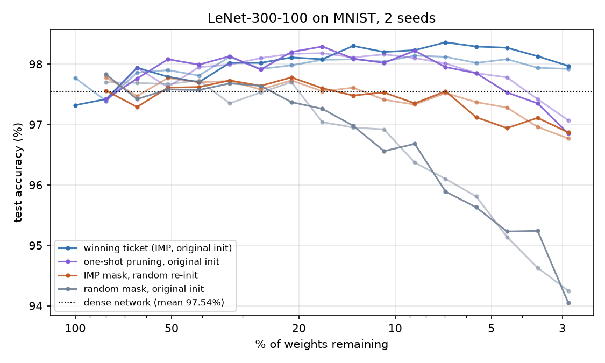

# lottery-ticket-eval

<!-- TODO(Mickey): rewrite this intro in your own words. -->

A reproduction of the Lottery Ticket Hypothesis (Frankle & Carbin, 2019) on
MNIST with LeNet-300-100, and an agent-evaluation task built from it.

## Results

Iterative magnitude pruning (IMP): train for 5 epochs, remove 20% of the
surviving hidden-layer weights (10% of the output layer) by magnitude, rewind
the survivors to their original initial values, repeat for 16 rounds. Each
point is a fresh 5-epoch training run evaluated on the MNIST test set.

At 2.87% of the weights remaining:

| | seed 0 | seed 1 |
|---|---|---|
| dense network (100%) | 97.32% | 97.77% |
| **winning ticket** (IMP mask, original init) | **97.97%** | **97.92%** |
| one-shot magnitude pruning, original init | 96.85% | 97.07% |
| IMP mask, random re-init | 96.87% | 96.77% |
| random mask, original init | 94.05% | 94.25% |

- The winning ticket keeps 1 in 35 weights and is still at least as
  accurate as the dense network.
- The same mask with a new random init loses about 1.1 points, so the
  initial values matter, not just the structure.
- Pruning in one shot instead of iteratively matches the ticket down to
  about 10% density and falls behind below that.
- A random mask of the same size loses almost 4 points.

## Agent task

`task/TASK.md` asks an agent to implement `find_mask`. The grader draws the
initial weights from a seed the agent doesn't see, hides the test set, trains
the returned mask from those weights with its own loop, and requires at most
3% density and at least 97.5% test accuracy within 20 minutes.

| Solution | seed 7 (grader default) | seed 8 |
|---|---|---|
| `task/starter` (one-shot, 3% per layer) | fail: 94.65% | fail: 95.32% |
| `task/reference` (IMP with rewinding) | pass: 97.90%, 56 s | pass: 98.01%, 55 s |

## Run it

    python -m venv .venv && .venv/bin/pip install torch numpy matplotlib
    mkdir -p data && for f in train-images-idx3-ubyte train-labels-idx1-ubyte \
        t10k-images-idx3-ubyte t10k-labels-idx1-ubyte; do
      curl -sfL -o data/$f.gz https://ossci-datasets.s3.amazonaws.com/mnist/$f.gz; done
    .venv/bin/python -m lottery.experiment --seed 0
    .venv/bin/python -m lottery.plot results/imp_seed0.json
    .venv/bin/python -m task.grader.grade task/reference/solution.py

Two seeds of the full experiment take about 8 minutes on an Apple M4 Pro.

## Reference

Frankle, J. & Carbin, M. (2019). *The Lottery Ticket Hypothesis: Finding
Sparse, Trainable Neural Networks.* ICLR 2019. arXiv:1803.03635.
